<!-- pernik:hello -->
<picture>
  <source media="(prefers-color-scheme: dark)" srcset="./pernik/hello-dark.svg" />
  
</picture>
<!-- /pernik:hello -->

I'm a science and tech enthusiast getting into software development, mostly backend.  
I like figuring out how the pieces behind an app fit together.

- 🔭 Learning Go right now.
- 🌱 Always picking up new tools along the way.
- 🧩 Made [Pernik](https://github.com/kocwng/pernik), comic-style widgets for profile READMEs. [Try it in the playground](https://kocwng.github.io/pernik/).
- 📚 Usually reading when I'm not coding.
- 💬 Happy to talk about anything science or tech.
- 🍌 Fun fact: bananas contain dopamine. It just doesn't reach your brain.

<!-- pernik:line -->
<picture>
  <source media="(prefers-color-scheme: dark)" srcset="./pernik/line-dark.svg" />
  
</picture>
<!-- /pernik:line -->

<!-- pernik:tape -->

https://github.com/user-attachments/assets/f62bed9f-9dad-485a-9299-be28900c66d6

Press play above, or open the <a href="https://kocwng.github.io/kocwng/tape/">tape player</a>.

<!-- /pernik:tape -->

<!-- pernik:stack-title -->
<picture>
  <source media="(prefers-color-scheme: dark)" srcset="./pernik/stack-title-dark.svg" />
  
</picture>
<!-- /pernik:stack-title -->

<!-- pernik:stack -->
<picture>
  <source media="(prefers-color-scheme: dark)" srcset="./pernik/stack-dark.svg" />
  
</picture>
<!-- /pernik:stack -->

<!-- pernik:data-title -->
<picture>
  <source media="(prefers-color-scheme: dark)" srcset="./pernik/data-title-dark.svg" />
  
</picture>
<!-- /pernik:data-title -->

<!-- pernik:data -->
<picture>
  <source media="(prefers-color-scheme: dark)" srcset="./pernik/data-dark.svg" />
  
</picture>
<!-- /pernik:data -->

<!-- pernik:infra-title -->
<picture>
  <source media="(prefers-color-scheme: dark)" srcset="./pernik/infra-title-dark.svg" />
  
</picture>
<!-- /pernik:infra-title -->

<!-- pernik:infra -->
<picture>
  <source media="(prefers-color-scheme: dark)" srcset="./pernik/infra-dark.svg" />
  
</picture>
<!-- /pernik:infra -->

<!-- pernik:ai-title -->
<picture>
  <source media="(prefers-color-scheme: dark)" srcset="./pernik/ai-title-dark.svg" />
  
</picture>
<!-- /pernik:ai-title -->

<!-- pernik:ai -->
<picture>
  <source media="(prefers-color-scheme: dark)" srcset="./pernik/ai-dark.svg" />
  
</picture>
<!-- /pernik:ai -->

<!-- pernik:bye -->
<picture>
  <source media="(prefers-color-scheme: dark)" srcset="./pernik/bye-dark.svg" />
  
</picture>
<!-- /pernik:bye -->
