I'm a science and tech enthusiast getting into software development, mostly backend. 
I like figuring out how the pieces behind an app fit together.

- 🔭 Learning Go right now.
- 🌱 Always picking up new tools along the way.
- 📚 Usually reading when I'm not coding.
- 💬 Happy to talk about anything science or tech.
- 🍌 Fun fact: bananas contain dopamine. It just doesn't reach your brain.

<!-- tape:start (tools/build.py fills in the link from tape.toml) -->

<!-- tape:end -->

### 🛠️ Tech Stack

  
  
  
  
  
  
  

🎶 Want a tape like this on your profile? <a href="./MAKE-YOUR-OWN.md">Make your own</a>.

